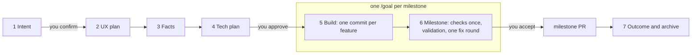
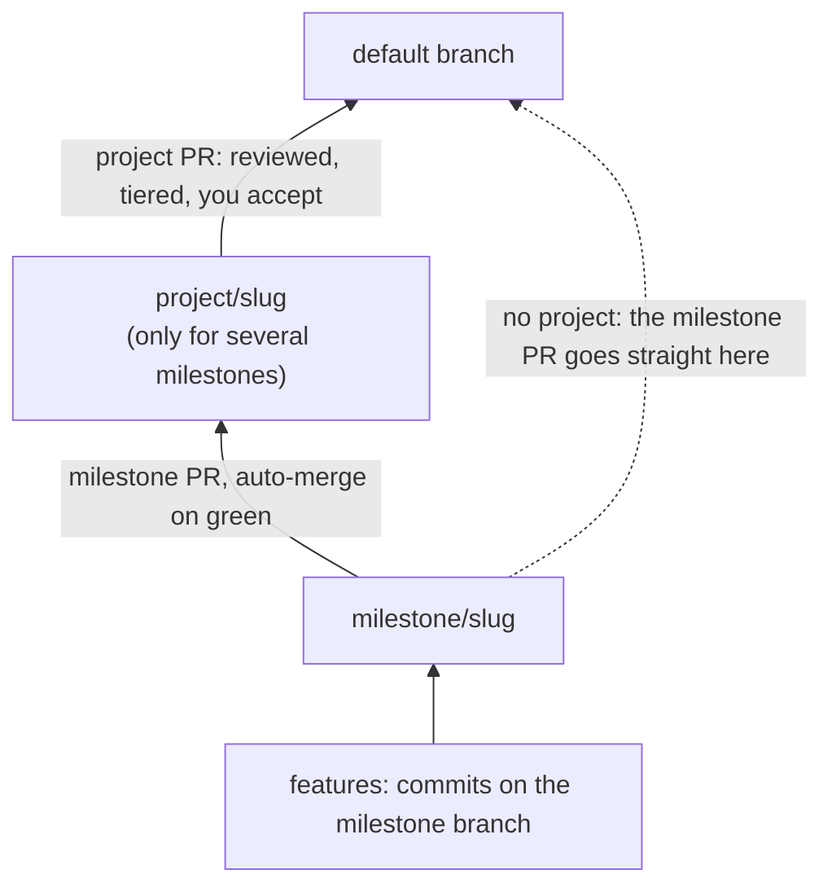
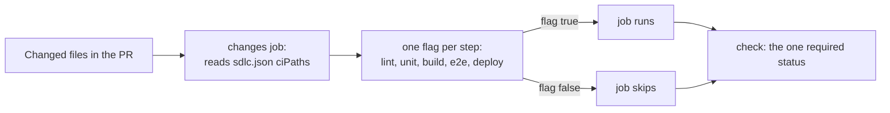

# sdlc-run, end to end

`/cct:sdlc-run` runs an AI-native software lifecycle in any repo. The agent drafts the intent, the UX plan, the facts and the tech plan. You confirm twice. Then one `/goal` builds the whole milestone as commits, runs the heavy checks once, and opens one PR.

There is also a [visual version of this page](sdlc-run-explained.html). It is a standalone HTML file: download it and open it in a browser.

Version described: sdlc-run 3.2.0. The runbook it follows is in [`plugins/cct/skills/sdlc-run/`](../plugins/cct/skills/sdlc-run/) (`SKILL.md`, `references/stages.md`, `references/ci-blueprint.md`, `references/adopt.md`).

## Stages and the two touchpoints



One change folder, `changes/<date>-<slug>/`, holds everything: intent, `spec/`, facts, plan, `done.json`, `lock.json`, `milestone.md`. Nothing lives only in a chat.

| Stage | What happens | Who |
|---|---|---|
| 1 Intent | One dialog picks ticket, design, size, kind, milestone and project. The agent drafts `intent.md`: your asks word for word, job stories, the success measure. | **You confirm** |
| 2 UX plan | Screens, states, words and components, planned against the repo's design rules. Skipped for size `none` or `ux: off`. | agent |
| 3 Facts | Short, testable sentences. Each cites an ask, names its screen or state, and names the E2E test that proves it. | agent |
| 4 Tech plan | Where the code goes and how the work splits into features. `done.json` holds "done" as data. | **You approve** stages 2, 3 and 4 in one review |
| 5 Build | Per feature: write its tests, build, commit, start the next at once. No check, lint or test runs between features. Open questions go to `questions.md` with the default taken and never block. | agent, inside `/goal` |
| 6 Milestone | Code review, UX review, accessibility, the full E2E suite once, every fact exercised in the built app, one fix round, `verify_gate.py milestone`, one PR. | agent, inside `/goal`; **you accept** (in one go only when a Critical or High finding would be deferred) |
| 6p Project | Only for work spanning several milestones: rebase, re-run the milestone checks on the whole project diff, one PR to the default branch. | **you accept** |
| 7 Outcome | Archive the folder when the change reaches the default branch. After release, read the success measure. A miss starts the next change. | agent, you read it |

The two touchpoints are the intent and the plan. After the plan is approved, `lock.json` locks facts, `done.json` and the checks; only your words can open them.

## One /goal per milestone

`delivery: "one-go"` is the default in `sdlc.json`. Everything you asked for at once is one change. One `/goal` builds every milestone in the plan, in order, each on its own branch `milestone/<slug>-<n>` cut from the previous one, so building never waits for a merge. Each feature is a commit. The milestone's checks run once, on the milestone diff.

`delivery: "feature-prs"` keeps the older shape: one PR per feature, auto-merged into the milestone branch. It suits teams building features in parallel.

Builders are `cct:builder` agents, at most four at once, each in its own worktree and test slot. The supervisor edits no code and runs no test suite.

## Branches, commits and PRs



```
<default> ─── milestone/<slug> ─── <feature commits>              one milestone
<default> ─── project/<slug> ─── milestone/<slug> ─── <features>  a project
```

**Commits, not PRs.** While a milestone is open, everything that belongs to it is a commit on `milestone/<slug>`: features, fixes found during the build, test and flaky-spec repairs, CI timeout tweaks its tests need, and records (plans, handovers, gate lines, `findings.md`, `validation.md`, `questions.md`). No PR holds only a record, a fix or a test repair.

**PRs that exist:**

- The milestone PR, into `project/<slug>` or the default branch.
- The project PR, into the default branch.
- Feature PRs, only with `delivery: "feature-prs"`.
- Other repositories, and a change you send to the default branch first.

**Only the PR into the default branch is reviewed and tiered.** Everything below it is an interior merge inside one change and auto-merges on its checks alone.

| PR | Checks | Claude review | Ship/Show/Ask | Who approves |
|---|---|---|---|---|
| feature to `milestone/*` (`feature-prs` only) | feature checks | no | no | nobody; auto-merge on green |
| milestone to `project/*` | milestone checks | no | no | nobody; auto-merge on green |
| `project/*` or `milestone/*` to the default branch | milestone checks | yes | yes | the tier decides |

Acceptance is separate from PR approval: you accept each milestone at stage 6, and the project at 6p, even though the interior PRs merge themselves. A hotfix goes straight to the default branch with feature checks only.

## The verify contract

`python3 scripts/verify_gate.py feature|milestone <id>` checks `lock.json`, runs the checks named in `sdlc.json`, writes `changes/<id>/verify/report.md`, and ends with exactly one line:

| Last line | The agent |
|---|---|
| `VERIFY PASS <scope> <id> <sha>` | moves on |
| `VERIFY FAIL ... check=<name>` | fixes that check and runs verify again |
| `VERIFY BLOCKED reason=<code>` | stops and asks you |

Blocked reasons: `not-approved`, `protected-path`, `no-progress`, `flaky`, `unknown-verdict`, `needs-baseline`, `allowlist-request`, `scope-growth`, `spec-conflict`, `env`, `test-proves-nothing`.

The agent may never build outside `/goal`, change the approved plan, edit a test to make it pass, start a second fix round at a milestone, decide scope for you, or open a PR for work that belongs to an open milestone.

## No waiting on CI

Measured on one real repo, one day: 39 CI runs, 22 failed, about 25 minutes each. 13 of 22 PRs were docs-only, yet ran the full pipeline and a preview deploy. One code PR waited 7 hours through 7 red runs that were all E2E timeouts on a dev server. Four rules keep the agent building while CI runs:

- **B1, records and fixes ride along.** They are commits on the milestone branch and ship in its one PR. The archive move is the last commit of the PR into the default branch.
- **C1, gate only on real code.** Wait for another PR only if this row's code imports, calls or edits something that exists only there. Then merge that branch locally and build on top. Tests, docs and unrelated rows are not dependencies.
- **C2, never idle.** After a push: arm auto-merge (`gh pr merge <n> --squash --auto`), watch in the background, start the next independent row. A red check interrupts; otherwise keep going.
- **C3, touched tests only.** A builder runs only the tests its change touched. The full suite runs once per milestone, and in CI only where A5 says.

## The CI blueprint, A1 to A6

`adopt` compares your CI with the blueprint and recommends each gap. A repo with no CI gets it written. Commands per stack are in `plugins/cct/skills/e2e-test-run/references/suite-speed-and-reliability.md`, section K.

| # | Rule |
|---|---|
| A1 | Each step (lint, unit, build, e2e, deploy) runs only when a changed path needs it. A docs change runs nothing and the one required status still reports success. |
| A2 | E2E runs against the built artifact, never a dev server that compiles on demand. |
| A3 | The slow suite is sharded over N jobs, each with its own database service. |
| A4 | One retry. A pass on retry is reported; it fails the run only on a full run. |
| A5 | Within the e2e step: the full suite runs only on PRs into the default branch or `project/*`, and on milestone heads. Other PRs run the touched specs. |
| A6 | `project/*` carries the same required `check`, so auto-merge waits for green (`milestone/*` too with `feature-prs`). |

### `ciPaths`: which paths run which step

Each repo lists its own paths in `sdlc.json` under `ciPaths`. One `changes` job reads them and sets a flag per step. A job runs only on its flag, and one job named `check` is the only required status, so a PR that skips everything still merges.



```json
"ciPaths": {
  "docs": ["changes/*", "docs/*", "*.md"],
  "all": [".github/workflows/*", "sdlc.json", "pnpm-lock.yaml"],
  "unit": { "include": ["src/*", "test/*", "*.test.*"], "exclude": ["e2e/*", "*.css"] }
}
```

(The real block has an `include` and `exclude` list for each of `lint`, `unit`, `build`, `e2e` and `deploy`.)

- A step runs for a file that matches its `include` and not its `exclude`. Globs are shell globs; `*` also crosses `/`.
- `docs` triggers nothing. `all` (lockfiles, CI workflows, `sdlc.json`) triggers every step.
- A file that matches no list triggers every step, so a forgotten path costs minutes, never a missed check.
- A YAML counts as docs only if nothing reads it. Workflows, app config, k8s and terraform YAML are code. Migrations are never excluded.
- `ciPaths` sits outside `checks`, so editing it does not need an unlock.

Example, for the TypeScript defaults:

| Changed file | Steps that run |
|---|---|
| `docs/guide.md` | nothing |
| `src/cart.ts` | lint, unit, build, e2e, deploy |
| `src/cart.test.ts` | lint, unit |
| `e2e/pay.spec.ts` | lint, e2e (touched specs) |
| `.github/workflows/ci.yml`, a lockfile, `sdlc.json` | everything |
| `tools/x.sh`, a file no list knows | everything |

## Commands per stack

| Stack | Touched tests | Production target | Shard | Retry |
|---|---|---|---|---|
| TypeScript, JavaScript | `vitest related --run`, `playwright test <specs>` | `next build && next start` | `playwright test --shard=i/N` | `retries: 1` |
| Python | `uv run pytest <files>` | built wheel in a clean env, or the container image | `pytest -n auto`; pytest-split across jobs | `pytest --reruns 1` |
| Rust | `cargo nextest run -p <crate>` | `cargo build --release`, test the binary | `--partition count:i/N` | `--retries 1` |
| Ruby, Rails | `bundle exec rspec <files>` | `RAILS_ENV=test`, eager load, assets precompiled | `parallel_rspec -n N`; knapsack across jobs | rspec-retry, 2 attempts |
| Kotlin | `./gradlew :module:test --tests 'pkg.FooTest'` | `installDist` or `bootJar`, run the jar | `maxParallelForks`; module matrix across jobs | `org.gradle.test-retry`, `maxRetries = 1` |
| Scala | `sbt "testOnly pkg.FooSpec"` | `sbt stage` or `assembly` | forked JVMs via `Test / testGrouping`; `testOnly` lists across jobs | ScalaTest `Retries` on a listed suite |

`ciPaths` defaults ship for all six stacks. The `adopt` presets exist for `node` and `python`; other stacks take the nearest preset and replace `checks.*` with the row above.

## How to adopt

Run `adopt` once per repo, from the repo root, on a branch:

```bash
/cct:sdlc-run adopt
```

It first asks whether to use Ship/Show/Ask merge tiers (a code owner approves risky PRs; the right answer for a one-owner repo is no). Then it installs:

- `sdlc.json`, from a preset, including the stack's default `ciPaths` (written once, never overwritten; edit the folder names to your repo's own).
- Hooks in `.claude/hooks/` that refuse edits outside `/goal` and to locked files, and `scripts/verify_gate.py`.
- The review and tier workflows, `docs/sdlc.md`, issue and PR templates, and a section for `CLAUDE.md`.

`adopt` never edits your own `ci.yml`. It compares it with the blueprint and recommends the gaps. Re-run it whenever the plugin updates, because the hooks and workflows are copies that do not update themselves.

Day to day:

```bash
/cct:sdlc-run add dark mode
/cct:sdlc-run
/cct:sdlc-run status
/cct:sdlc-run tracker
```

Start a change, continue the one on the current branch, list open changes and their gates, and choose the tracker (Linear, GitHub Projects, Beads or none). The plan's content always lives in the repo; the tracker only holds status and links.
