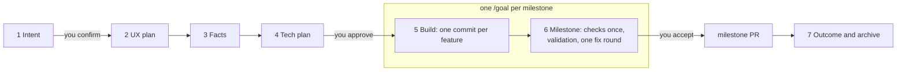
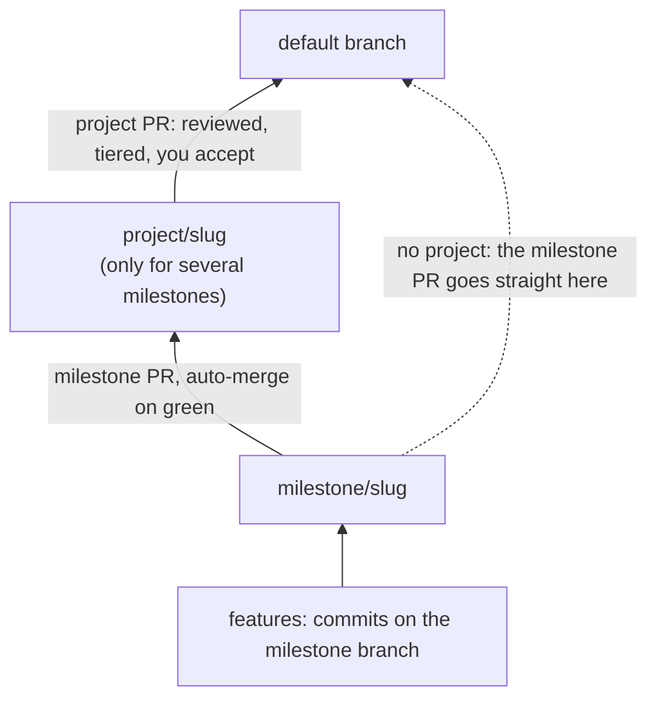
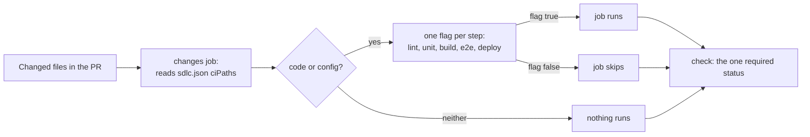

# sdlc-run, end to end

`/cct:sdlc-run` runs an AI-native software lifecycle in any repo. The agent drafts the intent, the UX plan, the facts and the tech plan. You confirm twice. Then one `/goal` builds the whole milestone as commits, runs the heavy checks once, and opens one PR.

There is also a [visual version of this page](sdlc-run-explained.html). It is a standalone HTML file: download it and open it in a browser.

Version described: sdlc-run 3.2.0. The runbook it follows is in [`plugins/cct/skills/sdlc-run/`](../plugins/cct/skills/sdlc-run/) (`SKILL.md`, `references/stages.md`, `references/ci-blueprint.md`, `references/adopt.md`).

## Stages and the two touchpoints



One change folder, `changes/<date>-<slug>/`, holds everything: intent, `spec/`, facts, plan, `done.json`, `lock.json`, `milestone.md`. Nothing lives only in a chat.

| Stage | What happens | Who |
|---|---|---|
| 1 Intent | One dialog picks ticket, design, size, kind, milestone and project. The agent drafts `intent.md`: your asks word for word, job stories, the success measure. | **You confirm** |
| 2 UX plan | Screens, states, words and components, planned against the repo's design rules. Skipped for size `none` or `ux: off`. | agent |
| 3 Facts | Short, testable sentences. Each cites an ask, names its screen or state, and names the E2E test that proves it. | agent |
| 4 Tech plan | Where the code goes and how the work splits into features. `done.json` holds "done" as data. | **You approve** stages 2, 3 and 4 in one review |
| 5 Build | Per feature: write its tests, build, commit, start the next at once. No check, lint or test runs between features. Open questions go to `questions.md` with the default taken and never block. | agent, inside `/goal` |
| 6 Milestone | Code review, UX review, accessibility, the full E2E suite once, every fact exercised in the built app, one fix round, `verify_gate.py milestone`, one PR. | agent, inside `/goal`; **you accept** (in one go only when a Critical or High finding would be deferred) |
| 6p Project | Only for work spanning several milestones: rebase, re-run the milestone checks on the whole project diff, one PR to the default branch. | **you accept** |
| 7 Outcome | Archive the folder when the change reaches the default branch. After release, read the success measure. A miss starts the next change. | agent, you read it |

The two touchpoints are the intent and the plan. After the plan is approved, `lock.json` locks facts, `done.json` and the checks; only your words can open them.

## One /goal per milestone

`delivery: "one-go"` is the default in `sdlc.json`. Everything you asked for at once is one change. One `/goal` builds every milestone in the plan, in order, each on its own branch `milestone/<slug>-<n>` cut from the previous one, so building never waits for a merge. Each feature is a commit. The milestone's checks run once, on the milestone diff.

`delivery: "feature-prs"` keeps the older shape: one PR per feature, auto-merged into the milestone branch. It suits teams building features in parallel.

Builders are `cct:builder` agents, at most four at once, each in its own worktree and test slot. The supervisor edits no code and runs no test suite.

## Branches, commits and PRs



```
<default> ─── milestone/<slug> ─── <feature commits>              one milestone
<default> ─── project/<slug> ─── milestone/<slug> ─── <features>  a project
```

**Commits, not PRs.** While a milestone is open, everything that belongs to it is a commit on `milestone/<slug>`: features, fixes found during the build, test and flaky-spec repairs, CI timeout tweaks its tests need, and records (plans, handovers, gate lines, `findings.md`, `validation.md`, `questions.md`). No PR holds only a record, a fix or a test repair.

**PRs that exist:**

- The milestone PR, into `project/<slug>` or the default branch.
- The project PR, into the default branch.
- Feature PRs, only with `delivery: "feature-prs"`.
- Other repositories, and a change you send to the default branch first.

**Only the PR into the default branch is reviewed and tiered.** Everything below it is an interior merge inside one change and auto-merges on its checks alone.

| PR | Checks | Claude review | Ship/Show/Ask | Who approves |
|---|---|---|---|---|
| feature to `milestone/*` (`feature-prs` only) | feature checks | no | no | nobody; auto-merge on green |
| milestone to `project/*` | milestone checks | no | no | nobody; auto-merge on green |
| `project/*` or `milestone/*` to the default branch | milestone checks | yes | yes | the tier decides |

Acceptance is separate from PR approval: you accept each milestone at stage 6, and the project at 6p, even though the interior PRs merge themselves. A hotfix goes straight to the default branch with feature checks only.

## The verify contract

`python3 scripts/verify_gate.py feature|milestone <id>` checks `lock.json`, runs the checks named in `sdlc.json`, writes `changes/<id>/verify/report.md`, and ends with exactly one line:

| Last line | The agent |
|---|---|
| `VERIFY PASS <scope> <id> <sha>` | moves on |
| `VERIFY FAIL ... check=<name>` | fixes that check and runs verify again |
| `VERIFY BLOCKED reason=<code>` | stops and asks you |

Blocked reasons: `not-approved`, `protected-path`, `no-progress`, `flaky`, `unknown-verdict`, `needs-baseline`, `allowlist-request`, `scope-growth`, `spec-conflict`, `env`, `test-proves-nothing`.

The agent may never build outside `/goal`, change the approved plan, edit a test to make it pass, start a second fix round at a milestone, decide scope for you, or open a PR for work that belongs to an open milestone.

## No waiting on CI

Measured on one real repo, one day: 39 CI runs, 22 failed, about 25 minutes each. 13 of 22 PRs were docs-only, yet ran the full pipeline and a preview deploy. One code PR waited 7 hours through 7 red runs that were all E2E timeouts on a dev server. Four rules keep the agent building while CI runs:

- **B1, records and fixes ride along.** They are commits on the milestone branch and ship in its one PR. The archive move is the last commit of the PR into the default branch.
- **C1, gate only on real code.** Wait for another PR only if this row's code imports, calls or edits something that exists only there. Then merge that branch locally and build on top. Tests, docs and unrelated rows are not dependencies.
- **C2, never idle.** After a push: arm auto-merge (`gh pr merge <n> --squash --auto`), watch in the background, start the next independent row. A red check interrupts; otherwise keep going.
- **C3, touched tests only.** A builder runs only the tests its change touched. The full suite runs once per milestone, and in CI only where A5 says.

## GitHub Actions setup

The CI is one workflow file, `plugins/cct/skills/sdlc-run/templates/ci/github-actions.yml`, for six stacks (`node`, `python`, `rust`, `ruby-rails`, `kotlin`, `scala`), with five setup steps:

1. **Copy the workflow.** `cp templates/ci/github-actions.yml .github/workflows/ci.yml`. `adopt` does it for a repo with no CI; a repo with its own CI copies the `changes` and `check` jobs and gates its jobs on their flags.
2. **Set `STACK`** at the top (and the version line for it) and the default branch in `on.push.branches`. Delete the `services:` block of `unit` and `e2e` if the repo has no database.
3. **Check `sdlc.json`.** `ciPaths` says which changed files run which step; `ciCommands` says what each job runs: `install`, `lint`, `unit`, `build`, `e2e` (with `{shard}` and `{total}`) and `e2eTouched` (with `{files}`). Defaults per stack ship in `templates/ci-paths.json` and `templates/ci-commands.json`; `adopt` fills them.
4. **Apply the A6 ruleset** (below), so `project/*` (and `milestone/*` with `feature-prs`) need the same status as the default branch.
5. **Make `check` the only required status.** Every other job hangs off it, and it reports even when every job was skipped.

If no code or config was touched, nothing runs. The only cost of such a PR is the `changes` job (about 10 seconds) and `check`: a required status that never reports leaves the PR unmergeable, so the workflow always starts.

### What runs for which file

| Changed file | Type | Steps |
|---|---|---|
| `README.md`, `docs/*`, `changes/*`, `.claude/*`, `*.txt`, an image | not code, not config | nothing |
| `src/*`, `app/*`, `*.ts`, `*.py`, `*.rs`, `*.rb` | code | lint, unit, build, deploy; e2e as touched specs, or the whole suite where the safety net applies |
| `test/*`, `*.test.*` | code (tests) | lint, unit |
| `e2e/*.spec.*` | code (a spec) | lint, e2e on that spec only |
| `*.css`, `*.scss` | code (styles) | lint, e2e, deploy; not unit |
| `drizzle/*`, `db/migrate/*`, `*.sql` | code (migrations) | unit, e2e, deploy |
| `package.json`, `tsconfig*.json`, `Dockerfile*`, `*.tf` | config | every step |
| `pnpm-lock.yaml`, `.github/workflows/*`, `sdlc.json` | config in `all` | every step |

### Worked example

The TypeScript defaults. Four PRs from a feature branch into `milestone/x`, then the same code into the default branch.

| PR changes | lint | unit | build | e2e | deploy | Why |
|---|---|---|---|---|---|---|
| `README.md`, `docs/guide.md` | skips | skips | skips | skips | skips | Both match `ciPaths.docs`. Only `changes` and `check` run. |
| `docs/img/diagram.png`, `README.md` | skips | skips | skips | skips | skips | An image outside the code folders is neither code nor config. Nothing runs. |
| `src/lib/price.ts` | runs | runs | runs | skips | runs | Code: every step's include matches. E2E skips because no spec changed; the whole suite runs on the PR into the default branch. |
| `e2e/login.spec.ts` | runs | skips | skips | runs (that spec) | skips | `e2e/*` is excluded from unit, build and deploy; `ciPaths.specs` names it a spec, so one leg runs just that file. |
| `src/lib/price.ts`, PR into the default branch | runs | runs | runs | runs (4 shards) | runs | The safety net: code in a PR into the default branch or `project/*`, or from `milestone/*`, runs every step and the whole suite. |
| any push to the default branch | runs | runs | runs | runs (4 shards) | runs | The same net, after the merge. |

The safety net costs one thing: a code file missing from `code` or `config`, in a PR that changes only that file, runs nothing until the push after the merge. Keep both lists complete. `scripts/test_ci_changes.sh` runs the template's real `changes` script against these cases.

### The `changes` job

An excerpt of `templates/ci/github-actions.yml` (the file has the rest: the other jobs, the stack setup for six stacks, the sharded `e2e` job with its database service, the `deploy` hook):

```yaml
  changes:
    name: Changed paths
    runs-on: ubuntu-latest
    timeout-minutes: 5
    outputs:
      lint: ${{ steps.f.outputs.lint }}
      unit: ${{ steps.f.outputs.unit }}
      build: ${{ steps.f.outputs.build }}
      deploy: ${{ steps.f.outputs.deploy }}
      full: ${{ steps.f.outputs.full }}
      matrix: ${{ steps.f.outputs.matrix }}
    steps:
      - uses: actions/checkout@3d3c42e5aac5ba805825da76410c181273ba90b1 # v7.0.1
        with:
          persist-credentials: false
          sparse-checkout: sdlc.json # only the path lists are needed
          sparse-checkout-cone-mode: false
      - id: f
        env:
          GH_TOKEN: ${{ github.token }}
          GH_REPO: ${{ github.repository }}
          PR: ${{ github.event.pull_request.number }}
          BASE: ${{ github.base_ref }}
          HEAD: ${{ github.head_ref }}
          DEFAULT: ${{ github.event.repository.default_branch }}
        run: |
          # >>> changes-script (scripts/test_ci_changes.sh runs exactly these lines)
          set -eu
          set -f # keep the globs literal
          # …
          list() { jq -r "(.ciPaths$1 // []) | join(\" \")" sdlc.json; }
          hit() { for g in $2; do case "$1" in $g) return 0 ;; esac; done; return 1; }
          # …
            while IFS= read -r f; do
              [ -n "$f" ] || continue
              hit "$f" "$IGNORE" && continue
              if hit "$f" "$ALL"; then everything; touched=true; continue; fi
              hit "$f" "$CODE" || continue # neither code nor config: runs nothing
              touched=true
              # …
              for s in $STEPS; do
                eval "inc=\"\$inc_$s\" exc=\"\$exc_$s\""
                # on a step when it matches the include and not the exclude
                if hit "$f" "$inc"; then known=true; hit "$f" "$exc" || eval "$s=true"; fi
              done
              # code or config that no step's include knows is a path you forgot to list: run everything
              $known || everything
            # …
            # safety net: where the full suite runs, any code or config change runs every step
            if [ "$touched" = true ] && [ "$full" = true ]; then everything; fi
          # …

  lint:
    name: Lint and types
    needs: changes
    if: needs.changes.outputs.lint == 'true'
    runs-on: ubuntu-latest
    timeout-minutes: 20
    steps:
      # checkout and the stack setup steps …
      - name: Lint (ciCommands.lint)
        run: |
          cmd=$(jq -r '.ciCommands.lint // empty' sdlc.json)
          if [ -z "$cmd" ]; then echo "::error::sdlc.json has no ciCommands.lint; set it (to true if this repo has no such step)"; exit 1; fi
          echo "+ $cmd"; bash -eo pipefail -c "$cmd"

  # The one required status. It always runs and always reports, so a PR that needed no job is still mergeable.
  check:
    name: check
    if: always()
    needs: [changes, lint, unit, build, e2e, deploy]
    runs-on: ubuntu-latest
    timeout-minutes: 5
    steps:
      - env:
          RESULTS: ${{ join(needs.*.result, ' ') }}
        run: |
          # skipped is fine: a flag said the step was not needed. failure or cancelled is not.
          case " $RESULTS " in *" failure "*|*" cancelled "*) echo "::error::a job failed: $RESULTS"; exit 1 ;; esac
          echo "all jobs passed or were skipped on purpose: $RESULTS"
```

## The CI blueprint, A1 to A6

Commands per stack are in `plugins/cct/skills/e2e-test-run/references/suite-speed-and-reliability.md`, section K.

| # | Rule |
|---|---|
| A1 | Each step (lint, unit, build, e2e, deploy) runs only when a changed code or config path needs it. A change that is neither runs nothing and the one required status still reports success. |
| A2 | E2E runs against the built artifact, never a dev server that compiles on demand. |
| A3 | The slow suite is sharded over N jobs, each with its own database service. |
| A4 | One retry. A pass on retry is reported; it fails the run only on a full run. |
| A5 | Within the e2e step: the full suite runs only on PRs into the default branch or `project/*`, on milestone heads and on pushes to the default branch. Other PRs run the touched specs. |
| A6 | `project/*` carries the same required `check`, so auto-merge waits for green (`milestone/*` too with `feature-prs`). |

### `ciPaths`: which paths run which step

Each repo lists its own paths in `sdlc.json` under `ciPaths`. One `changes` job reads them and sets a flag per step. A job runs only on its flag, and one job named `check` is the only required status.



```json
"ciPaths": {
  "docs": ["changes/*", "docs/*", "*.md"],
  "all": [".github/workflows/*", "sdlc.json", "pnpm-lock.yaml"],
  "code": ["src/*", "*.ts", "*.css"],
  "config": ["package.json", "Dockerfile*"],
  "specs": ["e2e/*.spec.*"],
  "unit": { "include": ["src/*", "test/*", "*.test.*"], "exclude": ["e2e/*", "*.css"] }
}
```

(The real block has an `include` and `exclude` list for each of `lint`, `unit`, `build`, `e2e` and `deploy`.)

- A file in `docs` (the optional "never runs anything" list) or in neither `code` nor `config` triggers nothing. `all` (lockfiles, CI workflows, `sdlc.json`) triggers every step.
- A code or config file runs the steps whose `include` matches it and whose `exclude` does not. Globs are shell globs; `*` also crosses `/`.
- A code or config file that no step lists triggers every step, so a forgotten path costs minutes, never a missed check.
- A YAML counts as ignorable only if nothing reads it. Workflows, app config, k8s and terraform YAML are config. Migrations are never excluded.
- `ciPaths` sits outside `checks`, so editing it does not need an unlock.

## Commands per stack

| Stack | Touched tests | Production target | Shard | Retry |
|---|---|---|---|---|
| TypeScript, JavaScript | `vitest related --run`, `playwright test <specs>` | `next build && next start` | `playwright test --shard=i/N` | `retries: 1` |
| Python | `uv run pytest <files>` | built wheel in a clean env, or the container image | `pytest -n auto`; pytest-split across jobs | `pytest --reruns 1` |
| Rust | `cargo nextest run -p <crate>` | `cargo build --release`, test the binary | `--partition count:i/N` | `--retries 1` |
| Ruby, Rails | `bundle exec rspec <files>` | `RAILS_ENV=test`, eager load, assets precompiled | `parallel_rspec -n N`; knapsack across jobs | rspec-retry, 2 attempts |
| Kotlin | `./gradlew :module:test --tests 'pkg.FooTest'` | `installDist` or `bootJar`, run the jar | `maxParallelForks`; module matrix across jobs | `org.gradle.test-retry`, `maxRetries = 1` |
| Scala | `sbt "testOnly pkg.FooSpec"` | `sbt stage` or `assembly` | forked JVMs via `Test / testGrouping`; `testOnly` lists across jobs | ScalaTest `Retries` on a listed suite |

`ciPaths` and `ciCommands` defaults ship for all six stacks. The `adopt` presets exist for `node` and `python`; other stacks take the nearest preset, set `STACK` by hand and replace `checks.*` with the row above.

## How to adopt

Run `adopt` once per repo, from the repo root, on a branch:

```bash
/cct:sdlc-run adopt
```

It first asks whether to use Ship/Show/Ask merge tiers (a code owner approves risky PRs; the right answer for a one-owner repo is no). Then it installs:

- `sdlc.json`, from a preset, including the stack's default `ciPaths` and `ciCommands` (written once, never overwritten; edit the folder names to your repo's own), and the `sdlcVersion` stamp.
- Hooks in `.claude/hooks/` that refuse edits outside `/goal` and to locked files, and `scripts/verify_gate.py`.
- The review and tier workflows, `docs/sdlc.md`, issue and PR templates, and a section for `CLAUDE.md`.

A repo with no CI gets `.github/workflows/ci.yml` from the template. `adopt` never edits your own CI: it prints the gaps and "copy the `changes` and `check` jobs from `templates/ci/github-actions.yml`". Re-run it whenever the plugin updates, because the hooks and workflows are copies that do not update themselves.

## Staying current

`adopt` writes `"sdlcVersion": "3.3.1"` into `sdlc.json`. Every time the skill runs in the repo, `status` and the verify gate compare the stamp with the installed plugin and print one line when it is missing or older, for example:

```text
This repo runs sdlc-run 3.2.0; the kit is 3.3.1. Run `adopt --upgrade` (changes: 3.3.1: adopt --upgrade never overwrites or moves anything; 3.3.0: the CI workflow ships as a template, ciPaths by file type, versioned repos).
```

A repo newer than the plugin is told to update the plugin. The verify gate prints it as a `WARN` line and never blocks.

`/cct:sdlc-run adopt --upgrade` is the safe path. It adds the keys a newer plugin introduced with the stack's defaults, never changes a value, stamps the new version and writes nothing else: no file overwritten, no folder moved. Each file that differs from the plugin's copy (a hook, `scripts/verify_gate.py`, `docs/sdlc.md`, the guardrail test) is listed as `review diff`, together with the manual migrations of `references/changelog.md` since your stamp. `adopt --upgrade --replace <file>` shows one file's diff; `adopt --upgrade --apply --replace <file>` replaces that file. A plain `adopt` refreshes every copy at once. `--dry-run` writes nothing.
